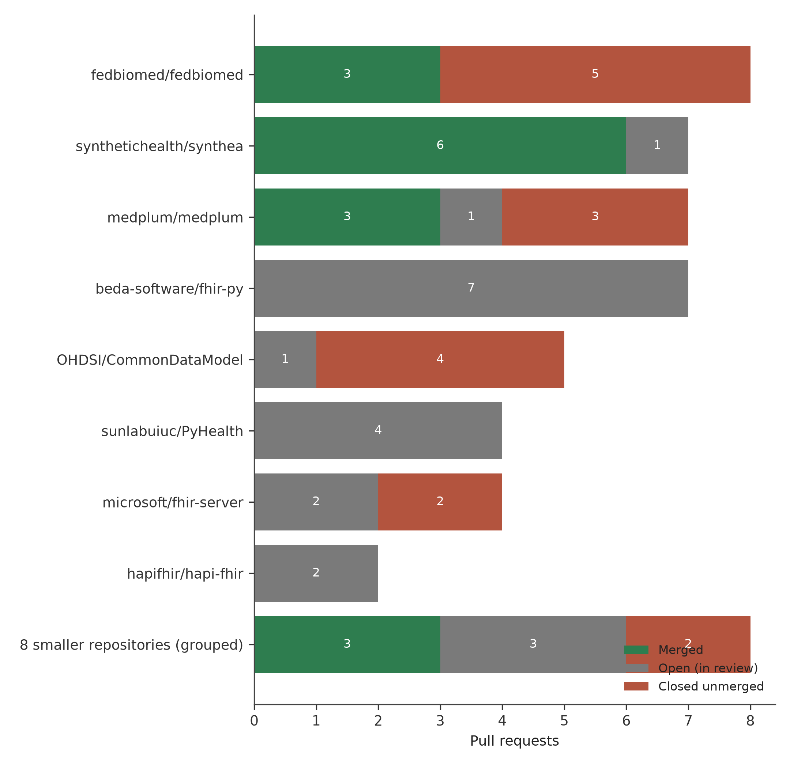
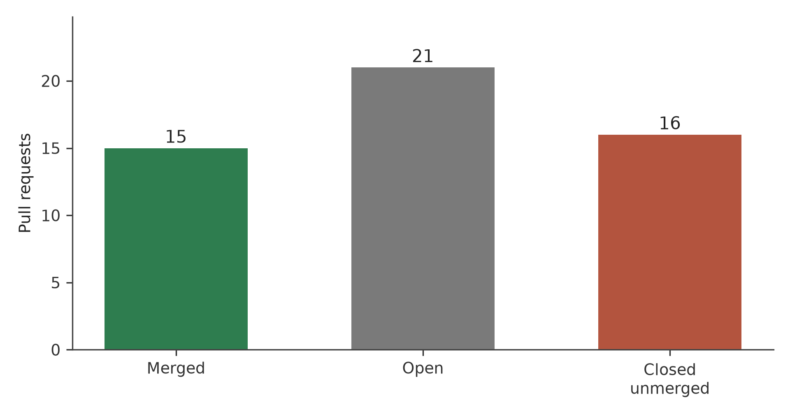
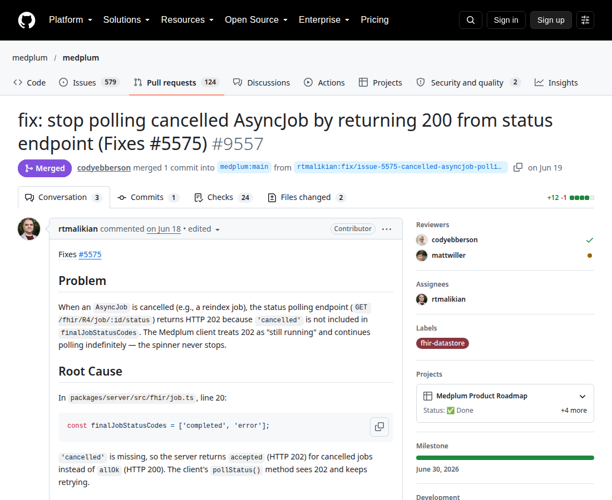

# 📄 Download the full article — PDF

[](https://github.com/rtmalikian/fhir-health-data-infrastructure-open-source/raw/main/article4-fhir-infrastructure.pdf)

### 👉 [**Click here to download the PDF**](https://github.com/rtmalikian/fhir-health-data-infrastructure-open-source/raw/main/article4-fhir-infrastructure.pdf)

*One click — no sign-up, no paywall. The full text is also embedded in this README below.*

---

# The Plumbing Layer: A Retrospective Analysis of Open-Source Contributions to FHIR Servers, Synthetic Patient Data, and Federated Research Infrastructure (2025-2026)

**Author:** Raphael T. Malikian, MBBS BSc (Hons), Independent Researcher, Palmdale, California, USA
**Profile:** https://github.com/rtmalikian

[](https://doi.org/10.5281/zenodo.23549199)
**Preprint:** [Zenodo](https://doi.org/10.5281/zenodo.23549199) | **License:** CC BY 4.0 | **PDF:** [article4-fhir-infrastructure.pdf](article4-fhir-infrastructure.pdf)

Submitted to JAMIA. Preprint: Zenodo.

## About this paper

This paper studies FHIR servers, synthetic patient data and federated research tools through 52 open-source pull requests in 16 repositories. Fifteen pull requests merged, 21 stayed open and 16 closed unmerged at extraction on 21 October 2026. The cases cover Synthea claim totals, a platelet volume range error, Medplum job polling, OpenEMR claims code and Fed-BioMed socket faults.

## Full article

## Abstract

**Background.** Clinical artificial intelligence gets the attention. The software below it gets less. Fast Healthcare Interoperability Resources (FHIR) servers move records between systems, synthetic patient generators supply data that real records cannot supply, and federated learning frameworks train models across hospitals without moving patient data. These projects are open source, and outside contributors write part of them.

**Purpose.** This study describes one contributor's pull requests (PRs) to that infrastructure layer, reports what merged and what did not, and asks why this domain accepted a smaller share of resolved work than the other domains in the same record.

**Methods.** The data source was the author's public GitHub record, extracted with the GitHub REST API on 21 October 2026 (search: author:rtmalikian, type:pr). The full record held 213 PRs across 94 repositories. This paper analyses the FHIR and clinical data infrastructure subset: 52 PRs in 16 repositories. Each PR was classed as merged, open, or closed unmerged. Six groups of cases were read closely.

**Results.** Fifteen of the 52 subset PRs merged, 21 remained open, and 16 closed unmerged. The merge share among the 31 resolved PRs was 48.4%, the lowest of the four domains in this series. Merges concentrated in three projects: Synthea (6 of its 7 PRs merged), Medplum (3 of 7), and Fed-BioMed (3 of 8). Ten of the 16 repositories merged none of the author's PRs. Seven PRs to one FHIR client library sat open with continuous integration blocked by a project secret that fork pull requests cannot read.

**Conclusions.** Infrastructure code is governed code. Standards-adjacent projects accept change slowly because a careless change travels far. The merged work was small and concrete: claim totals that add up, a lab range corrected by an order of magnitude, a socket that stopped leaking. The low acceptance rate says as much about governance and review capacity as about the changes themselves.
---

## 1. Introduction

Interoperability work rarely makes a keynote. It should. Digital medicine depends on interoperability, and the dependence is practical before it is technical: records that cannot move cannot be used [6]. HL7 FHIR is the current answer. The R4 specification defines resources, a RESTful interface, and rules for exchange [1]. A systematic review found FHIR adoption growing across care settings, with security and semantic consistency named as open problems [2]. SMART on FHIR built an app platform on the standard, so an app written against one record system could run against another [3]. FHIR was described in 2013 as an agile, REST-based approach to exchange [4], and later work used it for patient health records [5] and clinical research tools [7].

A standard needs software. Hospitals and researchers run FHIR servers, most of them open source, and the servers carry defects like any other code. A status endpoint that never tells a client to stop polling wastes compute on both ends. A type error in claims code stops a billing run. These are plain bugs. Their blast radius is not plain.
Synthetic data is the second piece. Real patient records sit behind privacy law and institutional review, and they should. Walonoski and colleagues built Synthea to close the gap: a generator that produces synthetic patients with plausible histories and exports them in formats that include FHIR [8]. Synthetic records let developers build and test without touching a real chart. That bargain holds only if the synthetic data is realistic. A claim total that does not equal the sum of its items teaches downstream software the wrong arithmetic. A laboratory reference range ten times too wide teaches a model the wrong physiology.

Federated learning is the third piece. The case was set out in 2020: hospitals hold data that could train better models, the data cannot move, so the model travels instead [9]. Federated training for medical image analysis across institutions followed [10], and reviews since then have catalogued the systems problems that remain [11,12]. A federation framework is a privacy programme written in code. When its plumbing fails, the failure lands on the programme, not on a test suite.

All three layers accept outside help through pull requests. Review in that model is shaped by maintainer workload and by how a contribution looks on arrival [13], and a contributor's review experience decides whether he returns [14]. Social signals, such as prior work in a project, sit beside technical quality in acceptance decisions [15]. Contributors judge each other from thin activity traces [16], and newcomers face barriers that include slow or absent feedback [17]. Software expertise itself is built through this kind of reviewed practice [18]. The plumbing layer is where those social facts meet heavy governance. That meeting is the subject of this paper.

### 1.1 Purpose of the Paper

Papers in this series divide one contributor's record by domain. The first covered clinical natural language processing and de-identification, the second covered medical imaging, and the third covered vector databases and retrieval. Each reported its own acceptance pattern. This fourth paper covers the largest subset in the record, and the one with the weakest resolved-outcome rate. That gap needs an explanation that goes past counting.

The paper asks three questions.

**RQ1.** What did the merged contributions in the FHIR and clinical data infrastructure subset actually fix, stated in operational terms?

**RQ2.** Why was the merge share among resolved PRs in this subset (48.4%) lower than in the other domains in the series?

**RQ3.** Which habits kept long waits and hard closures from turning into disputes with maintainers?

## 2. Methods

### 2.1 Data source and extraction

Data came from the GitHub REST API search endpoint on 21 October 2026, using the query `author:rtmalikian type:pr`. The search returned all 213 PRs in the author's public record, with no sampling. Repository names, PR numbers, titles, states, and merge or closure dates came from the API response. Review events discussed in depth are drawn from the public comment threads on the PRs themselves. Any reader can repeat the search and compare counts.

### 2.2 Subset definition

The subset was defined by repository function before any counting. A PR entered the subset if its target repository was a FHIR server or client library, a synthetic patient data generator, a federated research framework, an electronic health record, or a library whose main job is moving or modelling clinical data. Sixteen repositories met the rule: synthetichealth/synthea, fedbiomed/fedbiomed, medplum/medplum, beda-software/fhir-py, sunlabuiuc/PyHealth, microsoft/fhir-server, OHDSI/CommonDataModel, hapifhir/hapi-fhir, openemr/openemr, earthians/marley, the-momentum/open-wearables, the-momentum/fhir-mcp-server, beda-software/fhirpath-py, nazrulworld/fhir.resources, nazrulworld/fhir-core, and smart-on-fhir/client-py. The subset held 52 PRs. Clinical text processing, imaging, and retrieval work falls outside the rule and appears in the other papers of this series.

### 2.3 Status definitions

A PR was coded **merged** if the API recorded a merge timestamp, **closed unmerged** if its state was closed with no merge timestamp, and **open** if it was open at extraction. The merge share among resolved PRs is merged divided by merged plus closed unmerged. Open PRs are excluded from that share, and the paper says so wherever the number appears. An open PR is a censored observation. It may merge next week.

### 2.4 Case selection

Six groups of cases were read closely. Selection favoured merged work with a clear operational point (Synthea, Medplum, Fed-BioMed, OpenEMR), plus the two places where the record went badly (a blocked client library and a common data model project). A results section that reports only wins would teach nothing.

### 2.5 Contribution workflow under study

The workflow behind these PRs was fixed in advance. The defect had to be reproduced locally before a fix was written. Tests had to pass locally before the PR opened. The repository's own PR template outranked the author's habits. Every commit carried a Developer Certificate of Origin sign-off. Corrections went in as new commits on the same branch; history was never rewritten by force-push. When a maintainer request could be read two ways, the author asked one clarifying question and waited. Section 4.3 returns to these habits with the cases in hand.

### 2.6 Ethics

This study used public software records only. It involved no patient data, no clinical records, and no private messages. The one dataset discussed at length, Synthea output, is synthetic by design: the generator invents its patients [8]. Reporting follows the spirit of the STROBE and RECORD statements for observational work on routinely collected data [26,27].

## 3. Results

### 3.1 The subset in numbers

The subset held 52 PRs in 16 repositories. Fifteen merged (28.8% of the subset), 21 were open at extraction (40.4%), and 16 had closed unmerged (30.8%). Among the 31 resolved PRs, the merge share was 48.4%. The other domains in this series resolved higher: clinical NLP at 61.5%, medical imaging at 77.8%, and vector databases at 61.9%. Table 1 gives the split by repository. Figure 1 shows the eight largest repositories plus the eight smaller ones grouped. Figure 2 summarises the subset outcome.

The merges piled up in a few places. Synthea, Medplum, and Fed-BioMed produced 12 of the 15 merges between them. Ten of the 16 repositories merged none of the author's PRs. Two repositories, beda-software/fhir-py and sunlabuiuc/PyHealth, held 11 PRs with not one resolved at extraction.

**Table 1.** Pull requests in the FHIR and clinical data infrastructure subset, by repository and status at 21 October 2026.

| Repository | PRs | Merged | Open | Closed unmerged |
|---|---:|---:|---:|---:|
| fedbiomed/fedbiomed | 8 | 3 | 0 | 5 |
| synthetichealth/synthea | 7 | 6 | 1 | 0 |
| medplum/medplum | 7 | 3 | 1 | 3 |
| beda-software/fhir-py | 7 | 0 | 7 | 0 |
| OHDSI/CommonDataModel | 5 | 0 | 1 | 4 |
| sunlabuiuc/PyHealth | 4 | 0 | 4 | 0 |
| microsoft/fhir-server | 4 | 0 | 2 | 2 |
| hapifhir/hapi-fhir | 2 | 0 | 2 | 0 |
| openemr/openemr | 1 | 1 | 0 | 0 |
| earthians/marley | 1 | 1 | 0 | 0 |
| the-momentum/open-wearables | 1 | 1 | 0 | 0 |
| the-momentum/fhir-mcp-server | 1 | 0 | 1 | 0 |
| beda-software/fhirpath-py | 1 | 0 | 0 | 1 |
| nazrulworld/fhir.resources | 1 | 0 | 1 | 0 |
| nazrulworld/fhir-core | 1 | 0 | 1 | 0 |
| smart-on-fhir/client-py | 1 | 0 | 0 | 1 |
| **Total** | **52** | **15** | **21** | **16** |

**Figure 1.** Pull requests by repository and outcome at 21 October 2026, for the eight repositories with the most PRs in the subset. The remaining eight repositories are grouped. Synthea accepted nearly everything sent to it. The FHIR client library at the centre of the table accepted nothing and resolved nothing.



<!-- FIGURE 1 DATA: see figures/figures-data.txt -->

**Figure 2.** Outcome summary for the FHIR and clinical data infrastructure subset at 21 October 2026. Open PRs are the largest group. That is the picture of a slow domain, not a finished one.



<!-- FIGURE 2 DATA: see figures/figures-data.txt -->

### 3.2 Case studies

Table 2 lists the cases read closely. The text below gives each one its operational point. Figure 3 sits with the Medplum case, because that PR page shows a same-day merge, and the speed of it matters to Section 4.

**Table 2.** Cases selected for close reading.

| Case | Repository and PR | Outcome | Point of the case |
|---|---|---|---|
| 1 | synthetichealth/synthea #1676 | Merged 30 Jun 2026 | Claim.total set to the sum of item net values in FHIR exports |
| 2 | synthetichealth/synthea #1679 | Merged 2026 | Platelet distribution width reference range corrected from 150-520 to 9-17 fL |
| 3 | medplum/medplum #9557 | Merged 19 Jun 2026, same day | Cancelled AsyncJob status endpoint ended client polling |
| 4 | fedbiomed/fedbiomed #1806 | Merged 16 Jul 2026 | Socket leak on connection failure in a server liveness check |
| 5 | openemr/openemr #12525 | Merged 18 Jun 2026 | PHP 8 TypeError in claims processing counts |
| 6 | beda-software/fhir-py #163 and siblings | Open since Sep 2026 | CI blocked by a project secret that fork PRs cannot read |
| 7 | OHDSI/CommonDataModel, 5 PRs | 4 closed unmerged, 1 open | Code-first changes sent to a design-governed project |

**Case 1: Synthea, and arithmetic that has to be right.** Synthea generates synthetic patients and exports their records as FHIR [8]. In the export code, the total on a generated Claim resource was not set from the claim's own items. PR #1676 set Claim.total to the sum of the item net values, so a generated claim now adds up the way a real claim must. The fix is short. Its value sits downstream: teams train models and test billing logic on Synthea output, and a dataset whose claims contradict themselves teaches every consumer to tolerate contradiction.

Six of the seven Synthea PRs merged, all of the same size. PR #1678 corrected a string comparison to use .equals(). PR #1681 made a comparison in the FhirR4 exporter null-safe, so one missing field could no longer kill an export run. PR #1683 closed a stream the export code left open. PR #1674 fixed documentation. A maintainer team that answers small, correct changes with merges gets more of them. That is not sentiment. It is how the queue behaved.

**Case 2: A lab range off by an order of magnitude.** PR #1679 is the case I would put first if I had to pick one. Synthea generated platelet distribution width values against a reference range of 150 to 520. That range belongs to a platelet count. Platelet distribution width is measured in femtolitres, and its range sits near 9 to 17 fL. The generated data was wrong by an order of magnitude, in a field a clinician reads at a glance. Nobody had noticed, because synthetic data gets checked for shape more than for sense. The PR corrected the range. Section 4.2 takes up what this says about synthetic data review.

**Case 3: Medplum, and the value of a fast answer.** Medplum is an open-source FHIR server and platform [29]. PR #9557 fixed its AsyncJob status endpoint. When a job was cancelled, the response left clients polling for a status that would never change. Returning 200 for a cancelled job ends the loop. The PR opened and merged on the same day, 19 June 2026. Two sibling PRs merged in the same period: #9560 corrected encoding in the OAuth token exchange request, and #9561 fixed documentation. Three of the seven Medplum PRs closed unmerged, and Table 1 shows that too. The point stands anyway. A same-day merge tells a contributor his time was respected, and review experience drives return behaviour across GitHub [14]. I sent Medplum more work after #9557 than before it. I can confirm the mechanism from inside one record.

[FIGURE 3: Screenshot, medplum PR #9557 merged pull request page]

*Figure 3. The merged pull request page for medplum/medplum #9557, opened and merged on 19 June 2026.*



**Case 4: Fed-BioMed, where plumbing carries a privacy promise.** Fed-BioMed is a federated learning framework built for biomedical data [28]. Its nodes train models at hospitals and share model updates; the patient data stays where it is. PR #1806, merged 16 July 2026, fixed a socket leak in the server liveness check, is_server_alive(). When a connection failed, the socket was left open. A liveness check runs constantly, so the leak grows until the node runs out of file descriptors and falls over. PR #1819 removed a redundant close call and replaced an error message that pointed at the wrong cause. PR #1803 made error strings print an enum's value rather than its member name. Three of the eight Fed-BioMed PRs merged; five closed unmerged, the worst closure count in the subset after Case 7. Federation code gets read hard before it gets merged. Section 4.1 argues that this caution is correct, and that it explains part of the 48.4%.

**Case 5: OpenEMR, one PR, one merge.** OpenEMR is the most widely deployed open-source electronic health record in the world [30]. PR #12525, merged 18 June 2026, fixed a PHP 8 TypeError in Claim::payerCount() and Claim::procCount(). On a modern PHP runtime those methods could fail with a type error, and claims processing broke with them. A practice that cannot generate claims cannot bill. The fix was narrow and the test direct. One PR is a thin basis for general claims, and this paper makes none from it. The case earns its place because the user base is large and the failure was total for the affected workflow.

**Case 6: fhir-py, where CI cannot run.** beda-software/fhir-py is a Python library for working with FHIR resources. I opened seven PRs to it in September 2026, and all seven were still open at extraction. On PR #163 the continuous integration run fails for a reason that has nothing to do with the change: the test setup needs a project secret, a credential for a test server, and GitHub does not give repository secrets to workflows that run from forks. Every fork PR hits the same wall. On 10 October 2026 I posted the explanation on the thread, with the failing step named, so the maintainer could see the cause without digging. Then I waited. The explanation post was the whole of my move: state the facts once, in public, where the next contributor will find them too.

**Case 7: OHDSI CommonDataModel, a governance mismatch.** The Observational Health Data Sciences and Informatics programme runs a common data model so that one analytic can run against many databases [23]. I sent its repository five PRs. Four closed unmerged, and one sits open. Read plainly, that is a poor return. Read properly, it is a lesson in how the project governs change. A common data model changes by design discussion and community agreement first; code arrives after the agreement, as the record of a decision already made. My PRs arrived code-first, as if the repository were a library with a bug queue. Some were reasonable changes sent through the wrong door. I count this as my error in project selection. Section 4.3 says what I do differently now.


## 4. Discussion

### 4.1 Why this domain resolved at 48.4%

Three explanations fit the numbers, and the record supports each one in a different place.

Start with the blunt one. The bottleneck in health data infrastructure is governance and review, not code. The same contributor, using the same workflow, resolved at 61.5% in clinical NLP, 77.8% in medical imaging, and 61.9% in vector databases. In this subset the figure was 48.4%, with 21 of 52 PRs still open at extraction and 11 PRs in two repositories not resolved at all. The code did not get worse when it reached the plumbing layer. The doors got heavier.

The first explanation is governance weight. A FHIR server and a common data model are standards made executable. FHIR was presented as a deliberately incremental standard, built so change would not break existing exchange [4]. Implementers were still naming consistency as a live problem years later [2], and reviews of interoperability name organisational agreement beside technical standards as a condition for systems to work together [24]. A maintainer of standards-adjacent code who merges slowly is doing the job. Case 7 is the extreme form: a data model that changes by community decision cannot absorb code-first changes at any quality level. Fed-BioMed's five closures sit one step down. Federated learning in health care stands or falls on trust between institutions [9]. Code that holds other hospitals' trust gets reviewed like it.

FHIR conformance on paper is not interoperability in practice. A record system can implement the standard and still break claims processing on a current PHP runtime, as OpenEMR did before #12525. A FHIR server can answer every query in the specification and still leave clients polling a dead job, as Medplum did before #9557. The standard governs the shape of the exchange. It says nothing about whether the software survives a Tuesday.
The second explanation is review capacity. Forty percent of this subset sat open at extraction. Maintainers carry review as unpaid load and triage by signals of likely payoff [13,14]. A contributor with no history in a project waits longer and clears a higher bar [15]. I had no history in most of these 16 repositories. PyHealth [31] held four of my PRs with none resolved, and HAPI FHIR held two. Silence of that kind is a queue, not a verdict, though the person waiting can easily read it as one [16]. Table 1 should be read with that caution: 21 open PRs is a statement about maintainer hours at least as much as about code.

The third explanation is my own submission pattern, and it is the one I can change. I opened PRs in batches. Seven went to fhir-py in one month, and five went to the OHDSI data model project with no prior design discussion. Newcomers misreading project norms is a standard early failure [17]. A batch from a stranger reads as a dump: it asks a volunteer team to review a pile of work from someone whose name they met that morning. Sequenced submissions would have cost me nothing and asked less of them. Part of the 48.4% is a number I manufactured.

One structural factor sits outside anyone's behaviour. Case 6 shows a CI design that cannot pass for any outside contributor, because the test secret is withheld from fork workflows. The code may be fine. The gate cannot open. Projects that want outside help need a test path that runs without production-adjacent credentials, and the cost of not having one is invisible in their own dashboards: the PRs sit there, red, looking like failures.

### 4.2 Synthetic data needs clinical review

The Synthea cases carry a point past one generator. Kahn and colleagues built a shared vocabulary for health record data quality, with correctness named as its own dimension [20]. Weiskopf and Weng separated the question of whether data is complete from whether it is right [21]. The platelet distribution width range in Case 2 was schema-valid. Every generated value sat inside the stated range, and the stated range was wrong by an order of magnitude. A validator cannot catch that. A clinician reading the fixture can.

MIMIC-III was published with extensive description of how the real data was extracted and checked [22]. Synthetic data deserves a fraction of that care, applied at the generator. Synthea's disease modules were designed from published clinical knowledge [8]. Errors still creep in, one constant at a time, and they propagate into every dataset the generator produces. This kind of quiet dependency debt is the expensive kind [19].

Put the point at full strength. A bug in a generator does not produce one wrong record. It produces the same wrong fact in every dataset the generator ships, at scale, wearing the authority of a published tool. In this record the wrong facts were a claim total that ignored its own items and a laboratory range wrong by an order of magnitude, and both sat in the most widely used open synthetic patient generator until an outside contributor read the constants. The field audits synthetic realism too rarely, and it audits it less than it audits the models trained on the output. That order should be reversed.

### 4.3 Habits that kept waits from becoming disputes

The waits in this subset were long, and the closures at OHDSI and Fed-BioMed were final. None of them became an argument. The habits that did the work were each tested at least once.

I reproduced every defect locally before writing the fix. When a maintainer questions a change, the reproduction is the shared ground, and the conversation stays on the failing case. On fhir-py #163, where the failure was environmental, I posted the cause once, with the failing step named, and stopped. A second post would have been pressure, not information.

I never rewrote history on a branch under review. Corrections went in as new commits. A maintainer who has read a branch once can read the delta the second time; a force-push burns that work. When a maintainer request could be read two ways, I asked one question and waited. It costs a day. It saves the public correction that follows a confident guess.

At OHDSI I did the hardest thing on the list: I accepted that the closures were a governance answer, not a quality judgement, and I did not refile the changes in new clothing. Reading a project's norms this way is part of growing expertise [18], and cross-discipline work fails on mismatched expectations more than on technique [25]. The data model project expected design proposals. I sent patches. The expectations were published, and I had not read them closely enough.

### 4.4 Limits

This is one contributor, one platform, one extraction date. The author is also the subject, which cuts both ways: he has the thread history and the motives, and he has an interest in his own record. The counts are platform facts and can be checked by any reader. The explanations in Section 4.1 cannot be checked the same way, and they should be weighted as interpretation. Twenty-one PRs were still open at extraction, so the final merge share will move from the resolved figure of 48.4%. Merged is also not the same as used. This study did not track whether merged fixes reached releases or changed any running system. That tracking belongs in the follow-up work named below.

## 5. Conclusions

The infrastructure subset is the largest in this record and the least accepted, and both facts have the same root. FHIR servers, synthetic data generators, and federation frameworks are governed software. The changes that merged were small, concrete, and easy to verify: a claim total that sums its items, a laboratory range put right, a polling loop closed, a socket closed too. The changes that failed were sent in batches, sent code-first to a design-governed project, or blocked by a test gate no outsider can pass. A contributor who wants to help this layer should arrive slowly, one change at a time, through the door the project uses.

I keep contributing to this layer anyway. Models get replaced every year. The record formats, the generators, and the federation code stay. Work that lands there stays landed.
### 5.1 Future Work

Three follow-ups are practical. The first is a prospective multi-contributor replication: recruit contributors from several FHIR and synthetic data projects, log submissions and outcomes as they happen, and test whether the governance explanation in Section 4.1 survives a sample larger than one. Retrospective self-study can raise the hypothesis. It cannot carry it.

The second is a policy study. Large projects often cannot run full CI on fork pull requests because tests need secrets. A survey of health infrastructure projects could count how many have a secrets-free test path, and whether projects that build one resolve outside PRs faster. The fhir-py case gives the study its first data point.

The third is a realism audit of synthetic data at scale. The platelet distribution width error sat in a widely used generator for years. A systematic check of laboratory reference ranges and unit constants in Synthea's modules, compared against published ranges, would measure how common that class of error is. The audit method is dull. The findings would not be.

## Declarations

**Funding.** None. This work received no grant or sponsor support.

**Conflicts of interest.** The author declares no conflicts of interest and no industry affiliations of any kind. The author is an independent researcher.

**Data availability.** Every pull request analysed here is public at github.com/rtmalikian. A snapshot of the dataset extracted on 21 October 2026, with repository names, PR numbers, states, and merge or closure dates, is deposited with the published version of this paper.

**Ethics.** This study is not human-subjects research. It used public software records only and involved no patient data.

**Author contributions.** The author designed the study, extracted and coded the data, selected the cases, and wrote the paper.

## References

1. HL7 International. HL7 FHIR Release 4 specification. 2019. Available from: https://hl7.org/fhir/R4/
2. Ayaz M, Pasha MF, Alzahrani MY, Budiarto R, Stiawan D. The Fast Health Interoperability Resources (FHIR) standard: systematic literature review of implementations, applications, challenges and opportunities. JMIR Med Inform. 2021;9(7):e21929.
3. Mandel JC, Kreda DA, Mandl KD, Kohane IS, Ramoni RB. SMART on FHIR: a standards-based, interoperable apps platform for electronic health records. J Am Med Inform Assoc. 2016;23(5):899-908.
4. Bender D, Sartipi K. HL7 FHIR: an Agile and RESTful approach to healthcare information exchange. In: Proceedings of the 26th IEEE International Symposium on Computer-Based Medical Systems (CBMS 2013). Porto: IEEE; 2013. p. 326-331.
5. Saripalle R, Runyan C, Russell M. Using HL7 FHIR to achieve interoperability in patient health record. J Biomed Inform. 2019;94:103188.
6. Lehne M, Sass J, Essenwanger A, Schepers J, Thun S. Why digital medicine depends on interoperability. NPJ Digit Med. 2019;2:79.
7. Duda SN, Kennedy N, Conway D, Cheng AC, Nguyen V, Zayas-Caban T, et al. HL7 FHIR-based tools and initiatives to support clinical research: a scoping review. J Am Med Inform Assoc. 2022;29(9):1642-1653.
8. Walonoski J, Kramer M, Nichols J, Quina A, Moesel C, Hall D, et al. Synthea: an approach, method, and software mechanism for generating synthetic patients and the synthetic electronic health care record. J Am Med Inform Assoc. 2018;25(3):230-238.
9. Rieke N, Hancox J, Li W, Milletari F, Roth HR, Albarqouni S, et al. The future of digital health with federated learning. NPJ Digit Med. 2020;3:119.
10. Sheller MJ, Edwards B, Reina GA, Martin J, Pati S, Kotrotsou A, et al. Federated learning in medicine: facilitating expert collaborations for image analysis. Sci Rep. 2020;10(1):12598.
11. Xu J, Glicksberg BS, Su C, Walker P, Bian J, Wang F. Federated learning for healthcare informatics. J Healthc Inform Res. 2021;5(1):1-19.
12. Kairouz P, McMahan HB, Avent B, Bellet A, Bennis M, Bhagoji AN, et al. Advances and open problems in federated learning. Found Trends Mach Learn. 2021;14(1-2):1-210.
13. Gousios G, Pinzger M, van Deursen A. An exploratory study of the pull-based software development model. In: Proceedings of the 36th International Conference on Software Engineering (ICSE 2014). New York: ACM; 2014. p. 345-355.
14. Gousios G, Zaidman A, Storey MA, van Deursen A. Work practices and challenges in pull-based development: the contributor's perspective. In: Proceedings of the 38th International Conference on Software Engineering (ICSE 2016). New York: ACM; 2016. p. 285-296.
15. Tsay J, Dabbish L, Herbsleb J. Influence of social and technical factors for evaluating contribution in GitHub. In: Proceedings of the 36th International Conference on Software Engineering (ICSE 2014). New York: ACM; 2014. p. 356-366.
16. Marlow J, Dabbish L, Herbsleb J. Impression formation in online peer production: activity traces and personal profiles in GitHub. In: Proceedings of the 2013 Conference on Computer Supported Cooperative Work (CSCW 2013). New York: ACM; 2013. p. 117-128.
17. Steinmacher I, Silva MAG, Gerosa MA, Redmiles DF. A systematic literature review on the offerings of newcomers to open source software projects. Inf Softw Technol. 2015;59:412-422.
18. Baltes S, Diehl S. Towards a theory of software development expertise. In: Proceedings of the 26th ACM Joint European Software Engineering Conference and Symposium on the Foundations of Software Engineering (ESEC/FSE 2018). New York: ACM; 2018. p. 859-870.
19. Sculley D, Holt G, Golovin D, Davydov E, Phillips T, Ebner D, et al. Hidden technical debt in machine learning systems. In: Advances in Neural Information Processing Systems 28 (NeurIPS 2015). Montreal: Curran Associates; 2015. p. 2503-2511.
20. Kahn MG, Callahan TJ, Barnard J, Bauck AE, Brown J, Davidson BN, et al. A harmonized data quality assessment terminology and framework for the secondary use of electronic health record data. EGEMS (Wash DC). 2016;4(1):1244.
21. Weiskopf NG, Weng C. Methods and dimensions of electronic health record data quality assessment: enabling reuse in translational informatics. J Am Med Inform Assoc. 2013;20(1):144-151.
22. Johnson AEW, Pollard TJ, Shen L, Lehman LWH, Feng M, Ghassemi M, et al. MIMIC-III, a freely accessible critical care database. Sci Data. 2016;3:160035.
23. Hripcsak G, Duke JD, Shah NH, Reich CG, Huser V, Schuemie MJ, et al. Observational Health Data Sciences and Informatics (OHDSI): opportunities for observational researchers. Stud Health Technol Inform. 2015;216:574-578.
24. Torab-Miandoab A, Samad-Soltani T, Shams Asenjan A, Asadi F. Interoperability of heterogeneous health information systems: a systematic literature review. BMC Med Inform Decis Mak. 2023;23(1):18.
25. Amershi S, Begel A, Bird C, DeLine R, Gall H, Kamar E, et al. Software engineering for machine learning: a case study. In: Proceedings of the 41st International Conference on Software Engineering: Software Engineering in Practice (ICSE-SEIP 2019). Montreal: IEEE/ACM; 2019. p. 291-300.
26. von Elm E, Altman DG, Egger M, Pocock SJ, Gotzsche PC, Vandenbroucke JP, et al. The Strengthening the Reporting of Observational Studies in Epidemiology (STROBE) statement: guidelines for reporting observational studies. Lancet. 2007;370(9596):1453-1457.
27. Benchimol EI, Smeeth L, Guttmann A, Harron K, Moher D, Petersen I, et al. The REporting of studies Conducted using Observational Routinely-collected health Data (RECORD) statement. PLoS Med. 2015;12(10):e1001885.
28. Fed-BioMed. Fed-BioMed: a general framework and ecosystem for federated learning in biomedicine [software]. Available from: https://fedbiomed.org and https://github.com/fedbiomed/fedbiomed
29. Medplum. Medplum: open-source healthcare platform and FHIR server [software]. Available from: https://www.medplum.com and https://github.com/medplum/medplum
30. OpenEMR. OpenEMR: open-source electronic health records and medical practice management [software]. Available from: https://www.open-emr.org and https://github.com/openemr/openemr
31. PyHealth. PyHealth: a deep learning library for healthcare predictive modeling [software]. Available from: https://github.com/sunlabuiuc/PyHealth
32. Malikian R, et al. Development of a four-station knee wear simulator and preliminary results. J Bioeng Biomed Sci. 2013;3(2). doi:10.4172/2155-9538.1000125.

## How to cite

Malikian, R.T. (2026). The Plumbing Layer: A Retrospective Analysis of Open-Source Contributions to FHIR Servers, Synthetic Patient Data, and Federated Research Infrastructure (2025-2026). Zenodo. https://doi.org/10.5281/zenodo.23549199

```bibtex
@misc{malikian2026fhir,
  author = {Malikian, Raphael T.},
  title = {The Plumbing Layer: A Retrospective Analysis of Open-Source Contributions to FHIR Servers, Synthetic Patient Data, and Federated Research Infrastructure (2025-2026)},
  year = {2026},
  publisher = {Zenodo},
  doi = {10.5281/zenodo.23549199},
  url = {https://doi.org/10.5281/zenodo.23549199}
}
```

## Dataset

The dataset for this series is the author's full public pull request record: [malikian_pr_dataset_2026-10-21.csv](malikian_pr_dataset_2026-10-21.csv) (213 pull requests across 94 repositories, extracted from the GitHub API on 21 October 2026). This paper analyses a subset of 52 pull requests in 16 repositories.

## Open-Source Clinical AI Research Series

Part of the Open-Source Clinical AI Research Series by [Raphael T. Malikian](https://github.com/rtmalikian):

- [Clinical NLP and de-identification](https://github.com/rtmalikian/clinical-nlp-deidentification-open-source)
- [Medical imaging and DICOM reliability](https://github.com/rtmalikian/medical-imaging-dicom-open-source-reliability)
- [Vector databases and retrieval for clinical AI](https://github.com/rtmalikian/vector-databases-rag-clinical-ai-infrastructure)
